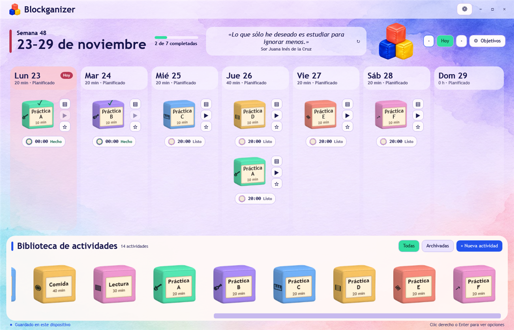
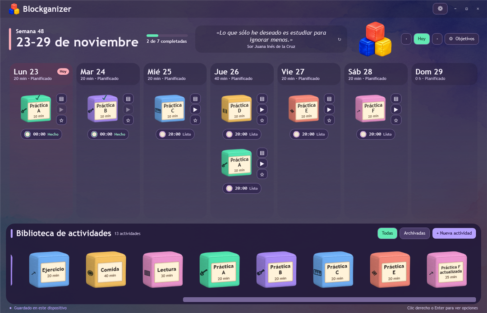

<p align="center"></p>

<h1 align="center">Blockganizer</h1>
<p align="center"><strong>Organiza tu semana, cubo por cubo.</strong></p>
<p align="center">Un planificador visual para Windows 11. Arrastra tus actividades al tablero y reutilízalas cada semana.</p>
<p align="center"><a href="https://github.com/TheSpiralDen/Blockganizer/releases/latest"><strong>↓ Descargar para Windows 11 x64</strong></a></p>



<details>
<summary>Ver el modo oscuro</summary>



</details>

## Así funciona

1. **Arma tu biblioteca.** Crea, edita o archiva cubos para tus actividades habituales.
2. **Planea la semana.** Arrastra los cubos a cualquier día y cambia su orden cuando lo necesites.
3. **Sigue tu ritmo.** Agrega notas y prioridades, pausa los temporizadores y consulta tus objetivos semanales.

Puedes alternar entre modo claro y oscuro y cambiar la frase del encabezado. Blockganizer funciona sin conexión y guarda tus actividades en una base SQLite local.

## Descargas

| Opción | Cómo abrirla |
| --- | --- |
| **Instalador MSI** | Abre el archivo MSI para instalar Blockganizer y agregarlo al menú Inicio. El instalador no tiene firma digital. |
| **Versión portable** | Extrae el ZIP completo y abre `Portable/Blockganizer.exe`. El ZIP también incluye el instalador y el código fuente. |

[Ver los archivos de la última versión](https://github.com/TheSpiralDen/Blockganizer/releases/latest)

## Compilar

Con Windows 11 x64 y .NET Framework 4.8 o posterior, ejecuta este comando desde la raíz del repositorio.

```powershell
powershell -NoProfile -ExecutionPolicy Bypass -File .\build.ps1
```

El resultado se genera en `dist`. Agrega `-AppOnly` para compilar únicamente el ejecutable. Los datos de la aplicación se guardan en `%LOCALAPPDATA%\Blockganizer\data\blockganizer.sqlite3`.
